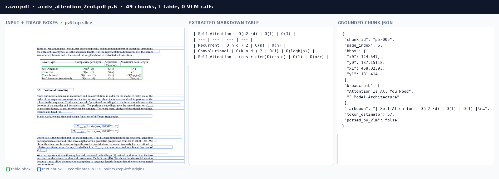
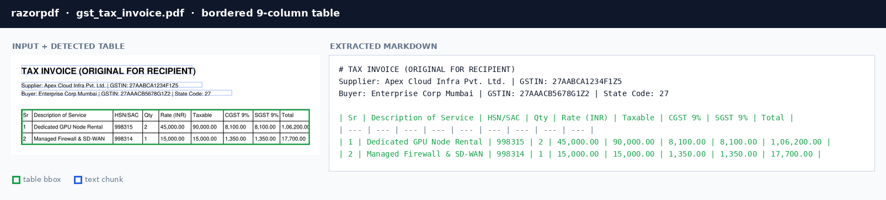
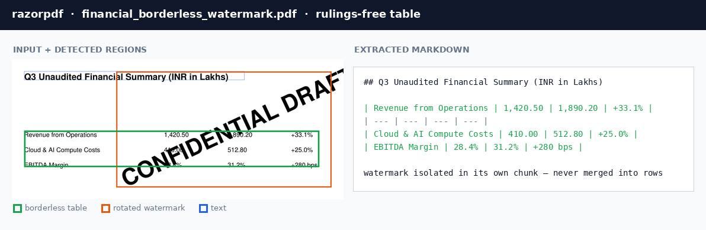

# razorpdf — Hybrid Geometric PDF Parser for RAG & MCP

[](https://github.com/shridhargsabat/razorpdf/actions/workflows/ci.yml)
[](https://github.com/shridhargsabat/razorpdf/blob/main/LICENSE)
[](https://pypi.org/project/razorpdf/)
[](https://crates.io/crates/razorpdf)
[](https://github.com/shridhargsabat/razorpdf)
[](https://github.com/shridhargsabat/razorpdf/tree/main/crates/razorpdf-py)

**Ultra-fast, local-first PDF parser: PDFs in, clean LLM-ready Markdown plus grounded RAG chunks out.**

Deterministic Rust geometry handles the easy 90%+ of document layouts in microseconds per page (`16,720 pages/sec` on synthetic benchmarks; `339 pages/sec` across real arXiv papers and tax invoices). Only genuinely messy sub-page regions ($S(R) \ge 0.45$) ever get cropped to WebP and sent to a Vision Language Model (VLM).



## Try it in 30 seconds

```bash
pip install razorpdf          # Python 3.10+, prebuilt wheels, no Rust needed
cargo install razorpdf        # CLI + MCP server from source
```

```python
import razorpdf
doc = razorpdf.parse_file("paper.pdf")   # -> {"markdown": ..., "chunks": [...]}
```

Prefer a binary? Grab one from [Releases](https://github.com/shridhargsabat/razorpdf/releases) (Linux shown):

```bash
curl -L -o razorpdf.tar.gz https://github.com/shridhargsabat/razorpdf/releases/download/v0.1.5/razorpdf-v0.1.5-x86_64-unknown-linux-gnu.tar.gz
tar xzf razorpdf.tar.gz && ./razorpdf parse paper.pdf -o paper.md --json paper.json
```

Or run the container (builds once, then parse + MCP server included):

```bash
git clone https://github.com/shridhargsabat/razorpdf.git && cd razorpdf
docker compose run --rm parse   # samples/invoice.pdf -> ./out/invoice.{md,json}
```

Prefer a prebuilt image? Each release publishes to GHCR:

```bash
docker run --rm -v ./samples:/work:ro ghcr.io/shridhargsabat/razorpdf:latest \
  parse /work/invoice.pdf
```

No Docker either? Try it in your browser:

[](https://colab.research.google.com/github/shridhargsabat/razorpdf/blob/main/docs/notebook/razorpdf_quickstart.ipynb)

## Why razorpdf?

Most PDF pipelines force an expensive tradeoff: flat text extractors mangle multi-column papers and borderless tables, while full-page vision/OCR pipelines burn seconds and thousands of image tokens on simple text pages. `razorpdf` combines both worlds:

| Capability | Flat Text Extractors (`pypdf`, `pdfminer`, `pymupdf`) | Full-Page VLM / OCR Pipelines | `razorpdf` (Hybrid Geometry + Sub-Page VLM) |
| :--- | :--- | :--- | :--- |
| **Throughput (117-page wild suite)** | 15–828 pages/sec (flat text only; fastest has fidelity gaps — see below) | < 1–5 pages/sec | **339 pages/sec (345 ms total) + tables as structure** |
| **Multi-column reading order** | Often interleaved across columns | Accurate (high latency) | **Deterministic recursive XY-cut** |
| **Table structure recovery** | Flattened into plain text lines | Full-page image inference | **R-tree vector grid + sub-page VLM fallback** |
| **VLM token cost** | Zero | Every page rendered & billed | **Cropped WebP of failing BBox only** |
| **Grounded RAG citations** | Page number only | Often ungrounded Markdown | **`page_index` + `{x0, y0, x1, y1}` bbox + breadcrumb trail** |
| **Offline operation** | Yes | Requires GPU / API | **Offline by default (graceful raw-text fallback)** |

### Why sub-page VLM wins on cost

Full-page vision pipelines pay image tokens for every page. `razorpdf` pays zero for geometric pages and only a small crop for the rest — measured on the wild suite:

| Input to the VLM | Pixels (150 dpi) | GPT-4o image tokens | Share of wild pages |
| :--- | ---: | ---: | :--- |
| Full page | 1241 × 1754 | 2,125 | — (what full-page pipelines send) |
| Full page, downscaled to 1024 px | 1024 × 1447 | 1,105 | — |
| **Sub-page crop** (financial table + 8 pt pad) | 1000 × 154 | **425** | 48 regions / 117 pages need any VLM |
| Pure-geometry page (both invoices) | — | **0** | majority of pages |

At typical frontier-VLM image pricing (~$2.50/1M input tokens, illustrative), that is ~$0.0053 per full-res page vs ~$0.0011 per crop — and geometry itself runs in ~60 µs/page with no model at all.

## What You Get Out

Pass any PDF via CLI, Python, or MCP and receive both structured Markdown and grounded RAG chunks with exact bounding boxes, heading hierarchies, token counts, and provenance flags:

```json
{
  "total_pages": 15,
  "markdown": "# Attention Is All You Need\n\n...",
  "chunks": [
    {
      "chunk_id": "p5-005",
      "page_index": 5,
      "bbox": {"x0": 124.5, "y0": 137.2, "x1": 468.0, "y1": 181.4},
      "breadcrumb": ["Attention Is All You Need", "3 Model Architecture"],
      "markdown": "| Self-Attention | O(n2 ·d) | O(1) | O(1) |\n| --- | ...",
      "token_estimate": 57,
      "parsed_by_vlm": false
    }
  ]
}
```

## Architecture

```text
PDF bytes
    │
    ▼
┌─────────┐   lopdf (pure Rust, rayon page-parallel)
│ EXTRACT │─── TextSpan + VectorSegment + image bboxes (top-left coords)
└─────────┘
    │
    ▼
┌──────────┐  line merge -> XY-cut reading order -> vector table grids
│ GEOMETRY │── multi-column safe, zero model calls
└──────────┘
    │
    ▼
┌────────┐  S(R) = min(1, 0.40·poverlap + 0.35·ptables + 0.25·pvectors)
│ TRIAGE │── fast path (< 0.45) or padded sub-page VLM region
└────────┘
    │
    │ WebP crop of BBox only (never full pages)
    ▼
┌─────┐  OpenAI / Gemini / Ollama / any OpenAI-compatible endpoint
│ VLM │── bounded concurrency, per-region failure tolerance
└─────┘
    │  │
    ▼  ▼
┌──────────┐ reading-order Markdown + chunks with
│ ASSEMBLE │── `{x0,y0,x1,y1}` bboxes + breadcrumb trails
└──────────┘
```

* **Fast path is pure geometry:** Line merging, recursive XY-cut, and R-tree vector-table reconstruction run in parallel across cores with zero model calls.
* **VLM fallback is sub-page:** Only the failing BBox is cropped to WebP and sent — a messy borderless table costs one small image crop, not a full-page render.
* **Chunks are grounded:** Every chunk carries its `chunk_id`, `page_index`, `bbox` (`{x0, y0, x1, y1}` in PDF points), heading `breadcrumb` trail, `token_estimate`, and the `parsed_by_vlm` provenance flag.
* **Offline by default:** No network calls run in tests or on the fast path. Without `--vlm-url` or `--mock-vlm`, messy regions keep their raw geometric text so content is never dropped silently.

## Quickstart


### 1. CLI (Rust)

```bash
cargo install razorpdf

# Parse a PDF to Markdown (stdout or file) plus grounded JSON chunks
razorpdf parse paper.pdf -o paper.md --json paper.json

# Inspect per-page spans, vectors, lines, tables, S(R) triage scores, and fallback regions
razorpdf inspect paper.pdf

# Route messy sub-page regions to local Ollama (or any OpenAI-compatible VLM endpoint)
razorpdf parse scan.pdf --vlm-url http://localhost:11434/v1/chat/completions

# Run an offline demo of the VLM fallback path using the deterministic mock provider
razorpdf parse messy.pdf --mock-vlm
```

From source: `git clone https://github.com/shridhargsabat/razorpdf.git && cd razorpdf && cargo build --release -p razorpdf`.

### 2. Python Bindings

`razorpdf` provides native Rust bindings via PyO3/maturin and releases the Python GIL during parsing so thread pools scale cleanly across CPU cores.

```bash
pip install razorpdf   # prebuilt abi3 wheels for Linux/macOS/Windows, Python 3.10+
```

```python
import razorpdf

# Full grounded document (dict with 'markdown' and 'chunks')
doc = razorpdf.parse_file("paper.pdf")
print(doc["markdown"][:500])
print(doc["chunks"][0]["bbox"], doc["chunks"][0]["breadcrumb"])

# Fast Markdown-only extraction (str)
md = razorpdf.to_markdown("paper.pdf")

# Route high-entropy regions to a local or cloud OpenAI-compatible VLM
doc = razorpdf.parse_file(
    "scan.pdf",
    vlm_url="http://localhost:11434/v1/chat/completions"
)
```

From source: `cd crates/razorpdf-py && pip install maturin && maturin develop --release`.

### 3. MCP Server (Claude Code / OpenCode / Hermes)

`razorpdf` includes a built-in Model Context Protocol (MCP) JSON-RPC 2.0 server over `stdio` exposing three tools: `parse_pdf`, `inspect_pdf_layout`, and `extract_pdf_tables`.

**Claude Code:**

```bash
claude mcp add razorpdf /path/to/razorpdf/target/release/razorpdf mcp
```

**OpenCode (`opencode.json`):**

```json
{
  "mcp": {
    "razorpdf": {
      "type": "local",
      "command": ["/path/to/razorpdf/target/release/razorpdf", "mcp"]
    }
  }
}
```

**Generic MCP / Hermes (`stdio` configuration):**

```json
{
  "name": "razorpdf",
  "transport": "stdio",
  "command": "/path/to/razorpdf/target/release/razorpdf",
  "args": ["mcp"]
}
```

**Example round-trip over `stdio`:**

```bash
echo '{"jsonrpc":"2.0","id":1,"method":"tools/call","params":{"name":"parse_pdf","arguments":{"path":"paper.pdf"}}}' | ./target/release/razorpdf mcp
```

```json
{
  "jsonrpc": "2.0",
  "id": 1,
  "result": {
    "content": [
      {
        "type": "text",
        "text": "{\"total_pages\":1,\"markdown\":\"# Sample Document\\n...\",\"chunks\":[{\"chunk_id\":\"p0-000\",\"page_index\":0,\"bbox\":{\"x0\":72.0,\"y0\":72.0,\"x1\":540.0,\"y1\":120.0},\"breadcrumb\":[\"Sample Document\"],\"parsed_by_vlm\":false}]}"
      }
    ]
  }
}
```

### 4. More ways to try

* **Gradio demo / HF Space:** `demo/` is a Space-ready app (upload a PDF, get Markdown + chunks + bbox view) — see `demo/README.md`.
* **Notebook:** [`docs/notebook/razorpdf_quickstart.ipynb`](docs/notebook/razorpdf_quickstart.ipynb) (Colab badge above).
* **RAG frameworks:** [`docs/integrations.md`](docs/integrations.md) — LangChain loader (tested, in `demo/`) + LlamaIndex snippet.
* **VLM providers:** [`docs/vlm-providers.md`](docs/vlm-providers.md) — Ollama, OpenAI, Gemini, and any OpenAI-compatible endpoint.

## CLI Reference

| Command | Purpose |
| :--- | :--- |
| `razorpdf parse <pdf> [-o out.md] [--json out.json] [--vlm-url URL] [--mock-vlm]` | Hybrid parse to Markdown + grounded JSON chunks |
| `razorpdf inspect <pdf>` | Per-page spans, vectors, lines, tables, $S(R)$ scores, and fallback regions |
| `razorpdf bench [--pages 400] [--json]` | Fast-path throughput benchmark on a synthetic multi-page document |
| `razorpdf mcp` (or `razorpdf --mcp`) | Start the MCP JSON-RPC 2.0 server over `stdio` |

## Examples

Bordered invoice table recovered exactly (green box), text around it untouched:



Rulings-free table under a rotated watermark — the watermark stays isolated in its own chunk and never merges into rows:



Machine-readable outputs live in [`examples/`](examples/) (Markdown + grounded JSON for both invoices and Attention Table 1).

## Benchmarks

### Synthetic Fast-Path Throughput

Measured with `razorpdf bench` (400-page mixed two-column, single-column, and bordered-table paper, fast path, no VLM; median of 3 timed runs after 3 warmups) on an AMD EPYC 9354P (4 vCPU):

| Build | Pages/sec | ms/page | Extract | Full Assembly |
| :--- | ---: | ---: | ---: | ---: |
| **debug** | 2,219 | 0.45 | 152.4 ms | 180.3 ms |
| **release** | **16,720** | **0.06** | **11.4 ms** | **23.9 ms** |

*Reproduce:* `cargo run --release -p razorpdf -- bench`
*Criterion suite:* `cargo bench -p razorpdf-core --bench throughput`

### Wild Head-to-Head (Real PDFs, Python API)

`scripts/bench_wild.py` benchmarks `razorpdf.parse_file` (release bindings) against flat extractors (`pypdf`, `pdfminer.six`, `pymupdf`) and fellow Rust parsers (`rasgapdf`, `oxidize-pdf`) on `tests/wild/*.pdf` (median of 3 runs after 1 warmup on the same EPYC 9354P machine; `razorpdf 0.1.1`, `pypdf 6.21.4`, `pdfminer.six 20260107`, `pymupdf 2.0`, `rasgapdf 0.3.3`, `oxidize-pdf 0.23.1`):

| File | Pages | `razorpdf` | `pypdf` | `pdfminer.six` | `pymupdf` | `rasgapdf` | `oxidize` |
| :--- | ---: | :--- | :--- | :--- | :--- | :--- | :--- |
| `arxiv_attention_2col` | 15 | 90 ms (167 p/s) | 1,556 ms (10 p/s) | 1,635 ms (9 p/s) | 112 ms (134 p/s) | **16 ms (912 p/s)** | 258 ms (58 p/s) |
| `arxiv_deepseek_tables` | 86 | 189 ms (456 p/s) | 2,856 ms (30 p/s) | 4,389 ms (20 p/s) | 198 ms (434 p/s) | **97 ms (887 p/s)** | 228 ms (378 p/s) |
| `financial_borderless_watermark` | 1 | <1 ms (3,069 p/s) | 2 ms (525 p/s) | 5 ms (182 p/s) | 2 ms (517 p/s) | **0 ms (empty output)** | 0 ms (5,161 p/s) |
| `gst_tax_invoice` | 1 | <1 ms (2,840 p/s) | 4 ms (263 p/s) | 8 ms (120 p/s) | 2 ms (453 p/s) | **0 ms (empty output)** | 0 ms (5,017 p/s) |
| `mozilla_tracemonkey_2col` | 14 | 65 ms (214 p/s) | 1,049 ms (13 p/s) | 1,559 ms (9 p/s) | 70 ms (201 p/s) | **27 ms (510 p/s)** | 52 ms (271 p/s) |
| **TOTAL** | **117** | **345 ms (339 p/s)** | **5,467 ms (21 p/s)** | **7,598 ms (15 p/s)** | **384 ms (305 p/s)** | **141 ms (828 p/s)*** | **538 ms (218 p/s)** |

\* `rasgapdf` 0.3.3 is genuinely the fastest flat extractor on the files it reads — but it returned **empty output for both generated invoices** (verified with path and bytes input), so its TOTAL is flattered by two instant empties. Compare per-file, and see fidelity/structure below.

### Content Fidelity & Structure Check

| File | `razorpdf` | `pypdf` | `pdfminer.six` | `pymupdf` | `rasgapdf` | `oxidize` |
| :--- | :---: | :---: | :---: | :---: | :---: | :---: |
| `gst_tax_invoice` | 5/5 | 5/5 | 5/5 | 5/5 | 0/5 (empty) | 5/5 |
| `arxiv_attention_2col` | 5/5 | 5/5 | 5/5 | 5/5 | 3/5 (miss: Table 1, O(n) | 5/5 |

| File | `razorpdf` rows | `pypdf` rows | `pdfminer` rows | `pymupdf` rows | `rasgapdf` rows | `oxidize` rows |
| :--- | ---: | ---: | ---: | ---: | ---: | ---: |
| `gst_tax_invoice` | **3** | 0 | 0 | 0 | 0 | 0 |
| `arxiv_attention_2col` | **13** | 0 | 0 | 0 | 0 | 0 |

Five backends recover the marker phrases, but only `razorpdf` reconstructs the tables as structured Markdown grids (the 3-row GST invoice grid and Attention's Tables 1–3 plus author block) rather than flat text.

### Model Pipelines (Docling)

Heavy vision/layout pipelines trade latency for structure. On the two single-page files (`docling 2.145.0`, models cached, same machine):

| File | Pages | `razorpdf` | `docling` |
| :--- | ---: | :--- | :--- |
| `financial_borderless_watermark` | 1 | <1 ms | 1,566 ms (1 p/s) |
| `gst_tax_invoice` | 1 | <1 ms | 3,382 ms (0 p/s) |

Docling matches razorpdf on the GST invoice (5/5 markers, 3 table rows) — at ~3,400× the latency. That's the gap the hybrid design closes: geometry gives you the structure in microseconds, and the VLM bill only arrives for regions geometry can't solve.

*Reproduce:* `.venv/bin/python scripts/bench_wild.py` (after `maturin develop --release`). The corpus is gitignored — fetch it first per `tests/wild/README.md`; the script degrades gracefully on a partial corpus.

## Triage Math

For each candidate region $R$, `crates/razorpdf-core/src/triage/scorer.rs` computes a visual complexity score $S(R)$:

$$S(R) = \min(1.0, 0.40 \cdot p_{\text{overlap}} + 0.35 \cdot p_{\text{tab\_entropy}} + 0.25 \cdot p_{\text{vector\_noise}})$$

* $p_{\text{overlap}}$: Share of spans touching a bounding-box overlap above `0.25` (*measured by span involvement so the ratio does not dilute on dense pages*).
* $p_{\text{tab\_entropy}}$: Set to `1.0` when $\ge 4$ consecutive $\ge 3$-island rows fail column bucketing (*jagged column counts or $x_0$ standard deviation above tolerance*).
* $p_{\text{vector\_noise}}$: Density of diagonal vector segments intersecting text spans.
* **Routing threshold:** Regions with $S(R) \ge 0.45$, scanned pages without text spans, and diagram clusters ($\ge 4$ vector segments) are padded, cropped to WebP, and sent to the configured VLM endpoint.

## Project Structure

```text
razorpdf/
├── crates/
│   ├── razorpdf-core/            # Engine: extract -> geometry -> triage -> VLM -> emit
│   │   ├── benches/throughput.rs # Criterion pages/sec benchmark suite
│   │   └── examples/dump_fixtures.rs
│   ├── razorpdf/             # Binary: parse / inspect / bench / mcp
│   └── razorpdf-py/              # PyO3 bindings: parse_file / to_markdown (+ GIL release)
├── scripts/
│   └── bench_wild.py             # Real-world PDF benchmark vs pypdf, pdfminer.six, pymupdf
└── tests/wild/                   # Wild-PDF corpus (gitignored, refetchable — see README.md)
```

## Roadmap

* **Completed (Phases 1–6):** Core geometric extraction, recursive XY-cut layout engine, R-tree vector table reconstruction, $S(R)$ triage scorer, sub-page WebP VLM client, MCP `stdio` server, and PyO3 bindings.
* **Planned:**
  * `pdfium` render backend (`--features pdfium`)
  * Exact token counting via vendored `tiktoken` ranks
  * Automatic region splitting for oversized blocks

## Contributing

Contributions, bug reports, and benchmark additions are welcome! Feel free to open an issue or submit a pull request on [GitHub](https://github.com/shridhargsabat/razorpdf).

## License

Licensed under either of:

* Apache License, Version 2.0 ([LICENSE-APACHE](https://github.com/shridhargsabat/razorpdf/blob/main/LICENSE-APACHE) or [http://www.apache.org/licenses/LICENSE-2.0](http://www.apache.org/licenses/LICENSE-2.0))
* MIT license ([LICENSE](https://github.com/shridhargsabat/razorpdf/blob/main/LICENSE) or [http://opensource.org/licenses/MIT](http://opensource.org/licenses/MIT))

at your option.
